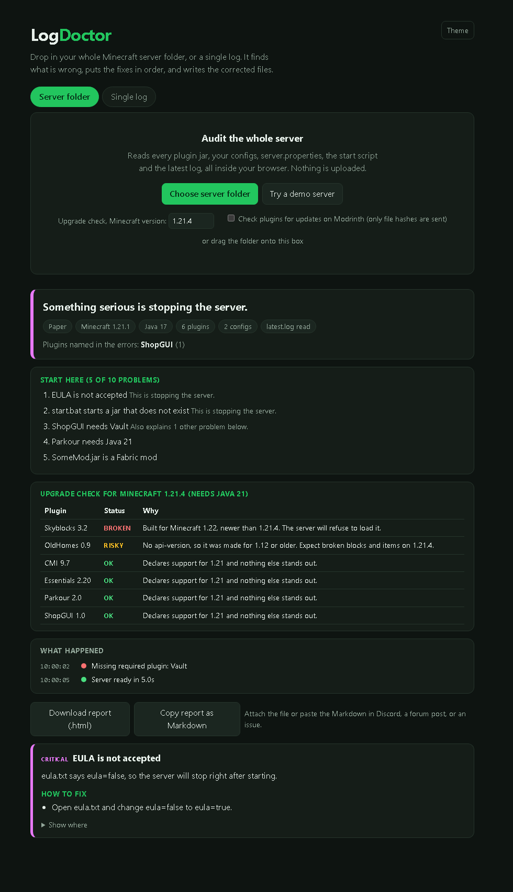

# LogDoctor

**Audit your whole Minecraft server folder, not just the log.** Drop in the folder and get the exact order to fix things, corrected config files, and a check of which plugins survive your next upgrade. Runs in your browser or a terminal. Nothing is uploaded.



Try it with no setup: open `docs/index.html` and press **Try a demo server**.

Log readers tell you what already broke. LogDoctor also reads the things that break it: every plugin jar, every config, `server.properties`, your start script and the latest log, and connects them.

## What it finds

**Before it crashes (folder audit)**
- Plugin jars: missing dependencies, plugins built for a newer Minecraft or Java than you run, two copies of the same plugin, jars with a missing main class, broken downloads, and Fabric, Forge or Velocity jars sitting in a Paper plugins folder
- Config files: tabs, duplicate keys, a missing space after a colon, apostrophes that break a string. You get a corrected copy to download, and your original is never touched
- `server.properties`, `eula.txt` and proxy settings: offline mode with no proxy, a bad `server-ip`, high view distance, weak RCON, an empty Velocity secret
- Start script: a jar that does not exist, Java flags that newer Java removed, too little RAM. It writes a start script with tuned flags sized to your heap

**After it crashes (log diagnosis)**
- 80 rules for common problems: wrong Java, watchdog freezes, lag, bad YAML, damaged chunks, mod conflicts, proxy forwarding, database trouble, out of memory
- Names the plugin from the jar name in the stack trace, from the plugin's main package in a folder audit, or from the mod list in a Forge crash report
- Understands pasted `/spark` health report output (TPS, tick durations, heap, garbage collection)
- Accepts a file, pasted text or an `mclo.gs` link

**Makes sense of the mess**
- **Start here:** a ranked plan. A missing dependency that explains five other errors ranks above those five
- **Side effects folded away:** errors that follow from a plugin that failed to load are tucked under their cause
- **Upgrade check:** enter the Minecraft version you want. Every plugin is marked `ok`, `check`, `risky` or `broken` for that version, and the Java version it needs is shown
- **Update check (optional):** looks your jars up on Modrinth by file hash and lists newer versions. Only hashes are sent, and only when you turn it on. Plugins that are not on Modrinth are reported as not checked, not as up to date
- **Shareable reports:** download one self-contained HTML file, or copy a Markdown report for Discord

## Use it in the browser

Open `docs/index.html`, or host the `docs` folder on GitHub Pages. Choose your server folder or drag it onto the page. For one log, use the **Single log** tab.

## Use it from the command line

You need Node 18 or newer.

```
node bin/logdoctor.js path/to/server
node bin/logdoctor.js path/to/server --target 1.21.4 --check-updates
node bin/logdoctor.js path/to/server --write-fixes --html report.html
node bin/logdoctor.js logs/latest.log
node bin/logdoctor.js https://mclo.gs/AbCdEf1
```

| Option | What it does |
| --- | --- |
| `--target <version>` | Upgrade check, for example `1.21.4` |
| `--check-updates` | Look jars up on Modrinth (sends file hashes only) |
| `--write-fixes [dir]` | Save corrected configs and a tuned start script. Originals are never changed |
| `--html <file>` | Write a self-contained HTML report |
| `--md` / `--json` | Markdown or JSON output |
| `--contact <text>` | Add a line to HTML and Markdown reports |
| `--verbose` | Also show low-priority notes |
| `--fail-on <level>` | Exit with code 1 if a finding is at least this severe. Default `error` |

## Use it in CI

```yaml
- uses: actions/checkout@v4
- uses: ITG3Hx/logdoctor@main
  with:
    path: ./test-server
    fail-on: error
```

Start a test server in your pipeline, then let LogDoctor audit its folder and fail the build when plugins do not load.

## Use it as a library

```js
const { analyze } = require('./src/engine.js');
const { auditServer } = require('./src/audit.js');
const { loadDir } = require('./src/fs-loader.js');

const log = analyze(fs.readFileSync('latest.log', 'utf8'));
const server = await auditServer(loadDir('/srv/minecraft'), { target: '1.21.4' });
console.log(server.verdict, server.plan);
```

Results have `info`, `findings`, `plan`, `timeline`, `culprits`, `verdict`, and for audits `pluginDetails`, `compat` and `updates`. In the browser, `auditServer` takes `{ path, size, read }` objects, so it works with the File API.

## Add a rule

Most rules are a small JSON file with a fixture, no code needed:

```json
{
  "id": "plugin-already-initialized",
  "severity": "error",
  "title": "Plugin was initialised twice",
  "match": "IllegalArgumentException: Plugin already initialized",
  "explain": "A plugin tried to create a second copy of itself.",
  "fix": ["Delete the older jar of the same plugin."],
  "fixture": "[10:00:00 ERROR]: java.lang.IllegalArgumentException: Plugin already initialized!"
}
```

Put it in `rules/packs/`. The test suite checks that every rule fires on its own fixture. See [CONTRIBUTING.md](CONTRIBUTING.md). Rules that need logic can still be written in JavaScript in `src/rules.js`.

## How well tested is it?

33 automated tests, plus runs against real logs and servers (modded client logs, a 6 MB log, and live Paper test servers). Running it on real logs removed a whole class of false alarms, such as harmless Mixin class probing being reported as errors. That is still far from thousands of logs. If it misses or misreads a log of yours, send it with IPs and names removed. Each one becomes a regression test.

## Limits

- It reads files. It does not run your server, so it cannot see live lag. Use a profiler such as spark for that, and paste the health report here
- It does not know whether a plugin has a newer release unless the update check finds it on Modrinth
- When it names a plugin, treat that as the best lead, not proof. When it can only guess from a package name, it shows the lowercase package word
- The YAML check is cautious and only flags mistakes that stop a file from loading

## Develop

```
npm test
```

This copies `src` into `docs` (so the web page runs the same code as the CLI), bundles the rule packs, and runs the tests.

## Need it fixed for you?

I audit and fix Minecraft servers, and write custom plugins. Message me on Discord: **trybution**.

If you host your own copy, set your contact line in `docs/site-config.js`. It is added to every report people download from your page.

## License

MIT
